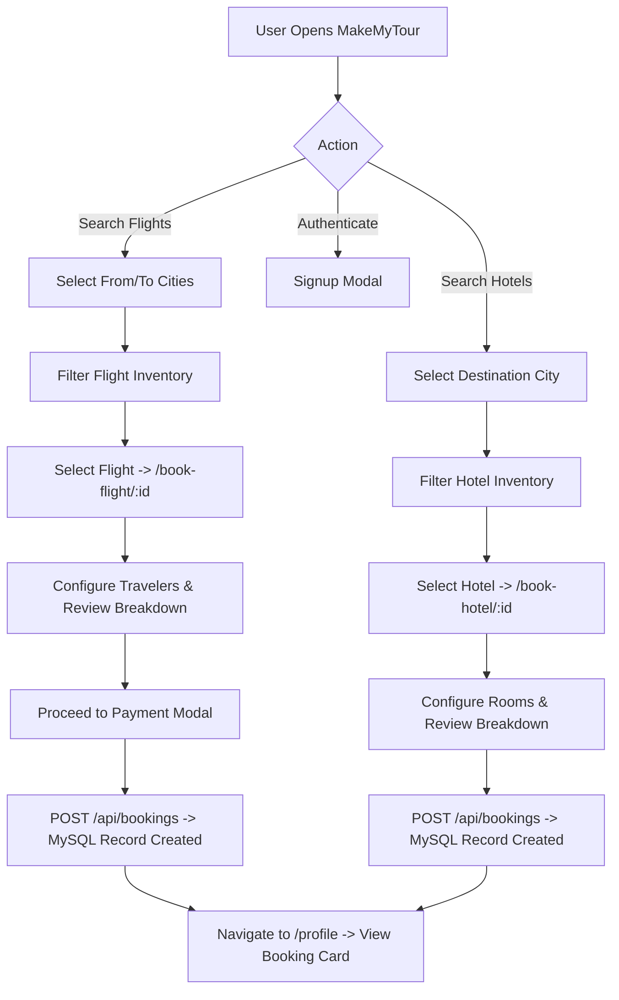

# MakeMyTour — Complete Technical Project Context & Architecture Knowledge Base

> **Document Type:** Comprehensive Repository & Architecture Audit  
> **Target Audience:** Engineering, Technical Onboarding, and AI Assistant Pair Programmers  
> **Repository Root:** `/Users/shrenuj/Desktop/make-my-trip-clone-springboot`  
> **Last Verified Audit Date:** October 24, 2026  

---

## 1. Project Identity and Overview

### 1.1 Project Name and Purpose
**MakeMyTour** is a full-stack travel booking web application inspired by MakeMyTrip. It provides end-to-end functionality for searching domestic/international flights and hotels, calculating trip fares with taxes and discounts, creating bookings associated with registered user profiles, and viewing booking history.

### 1.2 Intended Users and Use Cases
- **End-Traveler (Consumer):**
  - Sign up for a personal account (stored securely in MySQL).
  - Search available flights by departure ("From") and arrival ("To") cities.
  - Search hotels by city.
  - View flight and hotel details (fare breakdowns, cabin baggage allowances, room amenities).
  - Select traveler/ticket quantities and book flights or hotel stays.
  - Review booking history, booking IDs, statuses, and itinerary locations in the personal profile.
- **Administrator:**
  - Access administrative dashboards (`/admin`).
  - View existing inventory (flights and hotels).
  - Add new flights (airline, source, destination, departure/arrival schedules, price, seat inventory).
  - Add new hotels (hotel name, city, address, star rating, room inventory, price per night).
  - Search registered users by email address.

### 1.3 Main Business Workflows


### 1.4 Current Development Stage
The project is in **Active Development (MVP Stage)**:
- **Fully Functional End-to-End:**
  - User registration via API and UI dialog (creates hashed password record in MySQL).
  - Inventory retrieval for flights and hotels (`/api/flights`, `/api/hotels`).
  - Client-side search and filtering on the landing page based on database-backed inventory.
  - Flight booking lifecycle (route parameter parsing -> inventory fetch -> ticket selection -> booking entity creation in backend -> safe profile display).
  - Profile retrieval displaying real user information and real database booking records via `GET /api/bookings/user/{userId}`.
- **Partially Functional:**
  - Hotel booking (backend creates booking record; frontend mapping and state sync need refinement for room quantities).
  - Admin management (allows adding flights and hotels; editing and deleting throw errors due to missing backend endpoints).
- **Planned / Nonfunctional Placeholders:**
  - Real payment gateway integration (Stripe, Razorpay, etc.).
  - User login / session token verification (currently registration sets user in Redux; dedicated login endpoint does not exist).
  - Seat and room inventory decrement upon booking.
  - Profile editing endpoint (frontend displays graceful error message).
  - Cancellation UI on profile (backend has `PATCH /api/bookings/{id}/cancel`, but frontend profile has not wired up a cancel button).

---

## 2. Complete Technology Stack

### 2.1 Frontend (`makemytour/`)
| Layer | Technology | Declared Version | Role & Notes |
|---|---|---|---|
| **Framework** | Next.js (Pages Router) | `15.1.4` | Routing via `src/pages`, SSR/SSG capable, Fast Refresh |
| **Library** | React / React DOM | `^19.0.0` | Component lifecycle, modern hooks |
| **Language** | TypeScript | `^5` | Strict typings (`tsconfig.json`) |
| **Styling** | Tailwind CSS | `^3.4.1` | Utility-first CSS (`tailwind.config.ts`, `globals.css`) |
| **CSS Processing** | PostCSS / Autoprefixer | `^8` | Configured in `postcss.config.mjs` |
| **UI Primitives** | Radix UI | Radix UI suite (`^1.1` - `^2.1`) | Headless accessible components (Dialog, Dropdown, Tabs, Avatar) |
| **Icons** | Lucide React | `^0.471.1` | Modern SVG icons (`Plane`, `Building2`, `Calendar`, etc.) |
| **State Management** | Redux Toolkit | `^2.5.0` | Global user state (`src/store/index.js`) |
| **React Redux** | React-Redux | `^9.2.0` | React bindings for Redux |
| **HTTP Client** | Axios | `^1.7.9` | Base client with `baseURL` (`src/api/index.ts`) |
| **Class Utilities** | `clsx`, `tailwind-merge`, `cva` | Latest (`^2.1`, `^2.6`, `^0.7`) | Dynamic class merge utility (`src/lib/utils.ts`) |

### 2.2 Backend (`src/main/java/com/makemytrip/makemytrip/`)
| Layer | Technology | Declared Version | Role & Notes |
|---|---|---|---|
| **Language** | Java | `17` (Temurin/LTS) | Modern Java features (Records, Pattern Matching) |
| **Framework** | Spring Boot | `3.4.1` (`spring-boot-starter-parent`) | Core micro-framework |
| **REST / Web** | Spring MVC | Bundled with Boot | `@RestController`, `@RequestMapping` |
| **ORM / Persistence**| Spring Data JPA / Hibernate | Bundled with Boot | `JpaRepository`, Entity mappings, Transaction management |
| **Database Driver** | MySQL Connector/J | `mysql-connector-j` (Runtime) | JDBC connection to MySQL 8+ |
| **Security** | Spring Security | Bundled with Boot | Password hashing (`BCryptPasswordEncoder`), CORS filter |
| **Validation** | Bean Validation / Hibernate Validator | Bundled with Boot | `@Valid`, `@NotBlank`, `@Email` |
| **Build Tool** | Apache Maven | 3.9+ via `mvnw` | Dependency management and packaging |
| **Containerization**| Docker | Multi-stage build | JDK 17 JRE runtime image |

### 2.3 Database
- **Engine:** MySQL 8.x
- **Configured Database Name:** `makemytour`
- **Port:** `3306` (default local socket / TCP)
- **Schema Strategy:** `spring.jpa.hibernate.ddl-auto=update` (Hibernate automatically validates and updates schema on startup based on JPA entities).

---

## 3. Complete Repository Structure

```
make-my-trip-clone-springboot/
├── .gitignore
├── Dockerfile                             # Multi-stage Maven build & JRE 17 container
├── README.md                              # Root repository readme
├── mvnw / mvnw.cmd                        # Maven wrapper scripts
├── pom.xml                                # Spring Boot 3.4.1 Maven project definition
│
├── makemytour/                            # Frontend Next.js application
│   ├── .env.local                         # Local environment configuration (NEXT_PUBLIC_API_URL)
│   ├── components.json                    # Shadcn UI configuration file
│   ├── next.config.ts                     # Next.js configuration
│   ├── package.json                       # Frontend dependencies and run scripts
│   ├── postcss.config.mjs                 # PostCSS setup
│   ├── tailwind.config.ts                 # Tailwind design tokens and animations
│   ├── tsconfig.json                      # TypeScript compiler configuration
│   │
│   ├── src/
│   │   ├── api.ts                         # Re-export of src/api/index.ts
│   │   ├── api/
│   │   │   └── index.ts                   # Primary Axios API helper functions (active)
│   │   ├── components/
│   │   │   ├── Flights/
│   │   │   │   └── Flightlist.tsx         # Admin flight inventory table
│   │   │   ├── Hotel/
│   │   │   │   └── Hotel.tsx              # Admin hotel inventory table
│   │   │   ├── ui/                        # Radix UI wrapper primitives (button, dialog, etc.)
│   │   │   ├── Fotter.tsx                 # Application footer component
│   │   │   ├── Loader.tsx                 # Loading spinner component
│   │   │   ├── Navbar.tsx                 # Header navigation with profile & auth triggers
│   │   │   ├── SearchSelect.tsx           # Search dropdown for cities
│   │   │   └── SignupDialog.tsx           # User registration modal dialog
│   │   ├── lib/
│   │   │   ├── api.ts                     # Secondary/alternative Axios helper (unreferenced)
│   │   │   └── utils.ts                   # cn() helper using clsx and tailwind-merge
│   │   ├── pages/
│   │   │   ├── _app.tsx                   # Next.js custom app wrapped in Redux Provider & Navbar
│   │   │   ├── _document.tsx              # Custom HTML document wrapper
│   │   │   ├── index.tsx                  # Home landing page with search, offers & collections
│   │   │   ├── admin/
│   │   │   │   └── index.tsx              # Admin dashboard for flights, hotels, and user lookup
│   │   │   ├── api/
│   │   │   │   └── hello.ts               # Default sample Next.js API route
│   │   │   ├── book-flight/
│   │   │   │   └── [id]/index.tsx         # Flight booking details, pricing breakdown & booking action
│   │   │   ├── book-hotel/
│   │   │   │   └── [id]/index.tsx         # Hotel booking details, room selection & booking action
│   │   │   └── profile/
│   │   │       └── index.tsx              # User profile, edit form & live My Bookings section
│   │   ├── store/
│   │   │   └── index.js                   # Redux Toolkit store and user slice with localStorage sync
│   │   └── styles/
│   │       └── globals.css                # Tailwind base, components, and utilities
│
└── src/                                   # Backend Spring Boot source code
    ├── main/
    │   ├── java/com/makemytrip/makemytrip/
    │   │   ├── MakemytripApplication.java # Spring Boot main entry point
    │   │   ├── config/
    │   │   │   └── SecurityConfig.java    # Security filter chain, CORS configuration, BCrypt bean
    │   │   ├── controllers/
    │   │   │   ├── AdminController.java   # /api/flights, /api/hotels search and creation
    │   │   │   ├── BookingController.java # /api/bookings endpoints (create, get, user, cancel)
    │   │   │   ├── RootController.java    # / and /api/health monitoring endpoints
    │   │   │   └── UserController.java    # /api/users/register and /api/users list
    │   │   ├── models/
    │   │   │   ├── Booking.java           # Booking JPA entity (User, Flight, Hotel relationships)
    │   │   │   ├── Flight.java            # Flight JPA entity (airline, route, schedule, price)
    │   │   │   ├── Hotel.java             # Hotel JPA entity (name, city, rooms, pricePerNight)
    │   │   │   └── Users.java             # Users JPA entity (email, name, password hash, phone)
    │   │   ├── repositories/
    │   │   │   ├── BookingRepository.java # JpaRepository for Booking with findByUser_Id
    │   │   │   ├── FlightRepository.java  # JpaRepository for Flight with case-insensitive route search
    │   │   │   ├── HotelRepository.java   # JpaRepository for Hotel with case-insensitive city search
    │   │   │   └── UserRepository.java    # JpaRepository for Users with email uniqueness lookups
    │   │   └── services/
    │   │       ├── BookingService.java    # Transactional booking creation and cancellation logic
    │   │       └── UserServices.java      # User registration with BCrypt hashing and email checks
    │   └── resources/
    │       └── application.properties     # Port 4040, MySQL connection, JPA DDL configuration
    └── test/
        └── java/com/makemytrip/makemytrip/
            └── MakemytripApplicationTests.java # Spring context loading test
```

---

## 4. Frontend Page-by-Page Documentation

### 4.1 Home & Search Page
- **Path:** `makemytour/src/pages/index.tsx`
- **Route:** `/`
- **Purpose:** Primary landing page showcasing flight/hotel search, marketing banners, offers, and travel collections.
- **Data Flow & Hooks:**
  - `useEffect`: Calls `getflight()` and `gethotel()` on mount.
  - `useMemo`: Aggregates all unique cities from loaded flight and hotel records into `cityOptions` for dropdowns.
  - `handlesearch()`: Filters flights by `from` and `to` or hotels by `to` (city). **Note:** Filtering is performed client-side on the preloaded inventory arrays.
  - `handlebooknow(id)`: Navigates to `/book-flight/${id}` or `/book-hotel/${id}`.

### 4.2 Flight Booking Page
- **Path:** `makemytour/src/pages/book-flight/[id]/index.tsx`
- **Route:** `/book-flight/:id`
- **Purpose:** Displays detailed flight schedule, amenities, terminal information, fare rules, and dynamic price calculation.
- **Key Implementation Details:**
  - Robust route matching: Compares `String(flight.id) === String(flightId)` once `router.isReady` is true to avoid false "No flight data available" errors.
  - Fare Breakdown:
    - Base fare: `flight.price * quantity`
    - Taxes & Fees: Calculated dynamically based on quantity.
    - Grand Total: `totalPrice + totalTaxes + totalOtherServices - totalDiscounts`.
  - `handlebooking`:
    - Validates `user?.id` and `flight?.id`.
    - Calls `handleflightbooking(user.id, Number(flight.id), quantity, grandTotal)`.
    - Updates Redux state safely: `bookings: [...(user.bookings ?? []), data]`.
    - Closes dialog, resets quantity, and navigates via `await router.push("/profile")`.

### 4.3 Hotel Booking Page
- **Path:** `makemytour/src/pages/book-hotel/[id]/index.tsx`
- **Route:** `/book-hotel/:id`
- **Purpose:** Displays hotel information, guest policies, star ratings, and room quantity adjustments.
- **Key Implementation Details:**
  - Matches hotel ID from route query against `gethotel()` inventory.
  - Calculates night and room totals.
  - Modal confirmation calls `handlehotelbooking(user?.id, hotel?.id, quantity, grandTotal)`.
  - Navigates to `/profile` on completion.

### 4.4 Profile & My Bookings Page
- **Path:** `makemytour/src/pages/profile/index.tsx`
- **Route:** `/profile`
- **Purpose:** Account dashboard showing personal contact details and real booking history.
- **Key Implementation Details:**
  - **Normalization:** Contains `normalizeBooking` function that maps backend entity fields (`id`, `createdAt`, `status`, `totalPrice`, `flight`, `hotel`) into consistent UI fields.
  - **Date Safety:** Formats `createdAt` to locale string; displays `"Date unavailable"` if invalid or missing (prevents `"Invalid Date"`).
  - **Currency Safety:** Formats numbers safely as Indian Rupees (`₹`), handling nulls, numbers, or numeric strings.
  - **Booking Type & Route:**
    - If `flight` present: Displays airline name and route (`source → destination`).
    - If `hotel` present: Displays hotel name and city.
  - **Status & Payment:** Shows actual backend status (`CONFIRMED`, `CANCELLED`); displays `"Payment status unavailable"` for payment status since the backend has no payment table.
  - **Real DB Retrieval:** Fetches live bookings via `getuserbookings(user.id)`. Displays loading spinner, error state with retry, and an empty state if no bookings exist.
  - **Edit Form:** Synchronizes `name` (split into first/last) and `phone`. Displays an alert error message if saving is attempted, noting that backend profile editing is not yet implemented.

### 4.5 Admin Dashboard
- **Path:** `makemytour/src/pages/admin/index.tsx`
- **Route:** `/admin`
- **Purpose:** Inventory creation and management tabs for flights, hotels, and user lookups.
- **Key Implementation Details:**
  - Tabs for "Flights", "Hotels", and "Users".
  - Forms call `addflight()` (`POST /api/flights`) and `addhotel()` (`POST /api/hotels`).
  - User search calls `getuserbyemail()` (`GET /api/users` client-filtered).
  - **Security Notice:** There is currently no authentication or role guard protecting `/admin`.

---

## 5. Frontend State Management and Data Flow

### 5.1 Store Architecture (`src/store/index.js`)
```javascript
// Redux Toolkit configureStore
const userSlice = createSlice({
  name: "user",
  initialState: { user: null },
  reducers: {
    setUser: (state, action) => {
      state.user = action.payload;
      saveusertolocalstorage(action.payload);
    },
    clearUser: (state) => {
      state.user = null;
      localStorage.removeItem("user");
    }
  }
});
```

### 5.2 User Object Structure Variations
Because the frontend and backend evolved, the user object in Redux can have slight field variations:
1. **From Registration Response (`POST /api/users/register`):**
   ```json
   { "id": 1, "name": "John Doe", "email": "john@example.com", "phone": "9876543210" }
   ```
2. **From Legacy / Mock state:**
   ```json
   { "id": 1, "firstName": "John", "lastName": "Doe", "email": "john@example.com", "phoneNumber": "9876543210" }
   ```
3. **Handling in Profile Page:** The profile page inspects both `user.name` and `user.firstName`/`user.lastName`, and both `user.phone` and `user.phoneNumber`.

### 5.3 Refresh and Persistence Behavior
- User state is saved to browser `localStorage` on `setUser`.
- **Note on Initial Rehydration:** `_app.tsx` does not currently read `localStorage` back into Redux on hard refresh unless the user triggers an action. As a result, hard-refreshing might clear in-memory Redux state unless re-initialized.

---

## 6. Complete API Reference

All backend endpoints are hosted on port `4040` (`http://localhost:4040`).

| HTTP Method | Full Path | Controller & Method | Purpose | Request Body / Params | Backend Service / Repo | Frontend Helper | Status |
|---|---|---|---|---|---|---|---|
| `GET` | `/` | `RootController.home()` | App health & status | None | None | None | Verified Active |
| `GET` | `/api/health` | `RootController.health()` | Health check | None | None | None | Verified Active |
| `POST` | `/api/users/register` | `UserController.register()` | Register new user | JSON: `{ name, email, password, phone }` | `UserServices.register()` -> `UserRepository.save()` | `signup()` (`src/api/index.ts`) | Verified Active |
| `GET` | `/api/users` | `UserController.getUsers()` | List all users | None | `UserRepository.findAll()` | `getuserbyemail()` (`src/api/index.ts`) | Verified Active |
| `GET` | `/api/flights` | `AdminController.getFlights()` | List all flights | None | `FlightRepository.findAll()` | `getflight()` (`src/api/index.ts`) | Verified Active |
| `GET` | `/api/flights/search` | `AdminController.searchFlights()` | Search flights by route | Params: `source`, `destination` | `FlightRepository.findBySource...()` | `searchFlights()` (`src/lib/api.ts`) | Verified Active |
| `POST` | `/api/flights` | `AdminController.addFlight()` | Create new flight | JSON: Flight entity | `FlightRepository.save()` | `addflight()` (`src/api/index.ts`) | Verified Active |
| `GET` | `/api/hotels` | `AdminController.getHotels()` | List all hotels | None | `HotelRepository.findAll()` | `gethotel()` (`src/api/index.ts`) | Verified Active |
| `GET` | `/api/hotels/search` | `AdminController.searchHotels()` | Search hotels by city | Params: `city` | `HotelRepository.findByCity...()` | `searchHotels()` (`src/lib/api.ts`) | Verified Active |
| `POST` | `/api/hotels` | `AdminController.addHotel()` | Create new hotel | JSON: Hotel entity | `HotelRepository.save()` | `addhotel()` (`src/api/index.ts`) | Verified Active |
| `POST` | `/api/bookings` | `BookingController.createBooking()` | Create flight/hotel booking | JSON: `{ userId, flightId?, hotelId? }` | `BookingService.createBooking()` | `handleflightbooking()` / `handlehotelbooking()` | Verified Active |
| `GET` | `/api/bookings` | `BookingController.getBookings()` | List all bookings | None | `BookingService.getAllBookings()` | Fallback in `getuserbookings()` | Verified Active |
| `GET` | `/api/bookings/user/{userId}` | `BookingController.getUserBookings()` | Get bookings for specific user | Path: `userId` (Long) | `BookingRepository.findByUser_Id()` | `getuserbookings()` (`src/api/index.ts`) | Verified Active |
| `PATCH` | `/api/bookings/{bookingId}/cancel` | `BookingController.cancelBooking()` | Cancel a booking | Path: `bookingId` (Long) | `BookingService.cancelBooking()` | None (Pending UI) | Verified Active |

---

## 7. Complete Database Documentation

**Database Engine:** MySQL 8.x  
**Database Name:** `makemytour`  
**Configuration in `application.properties`:**
```properties
spring.datasource.url=jdbc:mysql://localhost:3306/makemytour
spring.datasource.username=root
spring.datasource.password=<MYSQL_PASSWORD>
spring.datasource.driver-class-name=com.mysql.cj.jdbc.Driver
spring.jpa.hibernate.ddl-auto=update
```

### 7.1 Entity & Table Schemas

#### 1. `app_users` Table (Entity: `Users.java`)
- **Table Name:** `app_users`
- **Purpose:** Stores user account credentials and contact info.
- **Columns:**
  | Column Name | SQL Type | Nullable | Constraints & Defaults | Notes |
  |---|---|---|---|---|
  | `id` | `BIGINT` | `NO` | Primary Key, Auto-Increment | User unique ID |
  | `email` | `VARCHAR(255)` | `NO` | Unique | Login / identity email |
  | `name` | `VARCHAR(255)` | `NO` | — | Full name |
  | `password` | `VARCHAR(255)` | `NO` | WRITE_ONLY in JSON | BCrypt hash (`$2a$...`) |
  | `phone` | `VARCHAR(255)` | `YES` | — | Contact telephone number |

#### 2. `flights` Table (Entity: `Flight.java`)
- **Table Name:** `flights`
- **Purpose:** Flight inventory catalog.
- **Columns:**
  | Column Name | SQL Type | Nullable | Constraints & Defaults | Notes |
  |---|---|---|---|---|
  | `id` | `BIGINT` | `NO` | Primary Key, Auto-Increment | Flight identifier |
  | `airline` | `VARCHAR(255)` | `NO` | — | Airline operator (e.g., "IndiGo") |
  | `source` | `VARCHAR(255)` | `NO` | — | Departure city |
  | `destination` | `VARCHAR(255)` | `NO` | — | Arrival city |
  | `departure_time`| `DATETIME(6)` | `YES` | — | Scheduled departure |
  | `arrival_time` | `DATETIME(6)` | `YES` | — | Scheduled arrival |
  | `price` | `DECIMAL(10,2)` | `NO` | — | Base ticket price |
  | `available_seats`| `INT` | `YES` | — | Available seat capacity |

#### 3. `hotels` Table (Entity: `Hotel.java`)
- **Table Name:** `hotels`
- **Purpose:** Hotel properties catalog.
- **Columns:**
  | Column Name | SQL Type | Nullable | Constraints & Defaults | Notes |
  |---|---|---|---|---|
  | `id` | `BIGINT` | `NO` | Primary Key, Auto-Increment | Hotel identifier |
  | `name` | `VARCHAR(255)` | `NO` | — | Hotel brand name |
  | `city` | `VARCHAR(255)` | `NO` | — | Location city |
  | `address` | `VARCHAR(255)` | `YES` | — | Street address |
  | `available_rooms`| `INT` | `YES` | — | Available room capacity |
  | `star_rating` | `INT` | `YES` | — | Hotel star rating (1-5) |
  | `price_per_night`| `DECIMAL(10,2)`| `NO` | — | Rate per night |

#### 4. `bookings` Table (Entity: `Booking.java`)
- **Table Name:** `bookings`
- **Purpose:** Booking records linking users to flights or hotels.
- **Columns:**
  | Column Name | SQL Type | Nullable | Foreign Key | Notes |
  |---|---|---|---|---|
  | `id` | `BIGINT` | `NO` | Primary Key, Auto-Increment | Booking identifier |
  | `user_id` | `BIGINT` | `NO` | FK -> `app_users.id` | EAGER fetch |
  | `flight_id` | `BIGINT` | `YES` | FK -> `flights.id` | EAGER fetch (Optional) |
  | `hotel_id` | `BIGINT` | `YES` | FK -> `hotels.id` | EAGER fetch (Optional) |
  | `status` | `VARCHAR(255)` | `NO` | Default `"CONFIRMED"` | Booking status |
  | `total_price` | `DECIMAL(10,2)`| `NO` | Default `0.00` | Calculated total |
  | `created_at` | `DATETIME(6)` | `NO` | Default `NOW()` | Timestamp created |

---

## 8. Booking Lifecycle Trace

Here is the exact step-by-step trace of a booking from user click to database write:

```
[User clicks "SEARCH" on Homepage]
       │
       ▼
[Client filters flight array and renders result cards]
       │
       ▼
[User clicks "Book Now"]
       │  Calls handlebooknow(result.id) in pages/index.tsx
       ▼
[Router navigates to /book-flight/[id]]
       │  pages/book-flight/[id]/index.tsx reads router.query.id
       ▼
[useEffect fetches all flights via getflight() and matches String(flight.id) === String(id)]
       │
       ▼
[User configures ticket quantity and reviews fare summary]
       │
       ▼
[User clicks "Book Now" in booking modal -> triggers handlebooking(e)]
       │  Validates user.id and flight.id
       ▼
[Calls handleflightbooking(user.id, Number(flight.id), quantity, grandTotal)]
       │  File: makemytour/src/api/index.ts
       │  Sends HTTP POST to http://localhost:4040/api/bookings
       │  Payload: { "userId": 2, "flightId": 1 }
       ▼
[Spring Boot BookingController receives request]
       │  File: controllers/BookingController.java:createBooking()
       │  Calls bookingService.createBooking(2, 1, null)
       ▼
[BookingService executes within @Transactional]
       │  File: services/BookingService.java
       │  1. Verifies user exists via userRepository.findById(2)
       │  2. Verifies flight exists via flightRepository.findById(1)
       │  3. Sets booking.setUser(user)
       │  4. Sets booking.setFlight(flight)
       │  5. Sets booking.setTotalPrice(flight.getPrice())  <-- Note: Uses flight price directly
       │  6. Sets booking.setStatus("CONFIRMED")
       │  7. Sets booking.setCreatedAt(LocalDateTime.now())
       │  8. Calls bookingRepository.save(booking)
       ▼
[MySQL executes INSERT INTO bookings]
       │  Assigns new auto-increment ID
       ▼
[Spring Boot returns Booking JSON entity to Frontend]
       │
       ▼
[handlebooking updates Redux store safely with setUser]
       │  dispatch(setUser({ ...user, bookings: [...(user.bookings ?? []), data] }))
       │  Calls await router.push("/profile")
       ▼
[Profile Page loads (/profile)]
       │  useEffect triggers fetchBookings()
       │  Calls getuserbookings(user.id) -> GET /api/bookings/user/2
       │  Maps response through normalizeBooking()
       │  Renders booking card with ID, localized date, route, price, and status
```

---

## 9. Flight Functionality

- **Data Model:** `Flight.java` contains `airline`, `source`, `destination`, `departureTime`, `arrivalTime`, `price`, `availableSeats`.
- **Field Mappings:**
  - Backend uses: `airline`, `source`, `destination`.
  - Frontend `src/api/index.ts:getflight()` maps them to:
    - `flightName: flight.airline`
    - `from: flight.source`
    - `to: flight.destination`
- **Route Matching Fix:** In `pages/book-flight/[id]/index.tsx`, the ID from `router.query` is cast to string (`String(flight.id) === String(flightId)`) after waiting for `router.isReady`, eliminating the previous `"No flight data available"` error.
- **Seat Availability Limitation:** Creating a booking currently does **not** decrement `availableSeats` in the database.

---

## 10. Hotel Functionality

- **Data Model:** `Hotel.java` contains `name`, `city`, `address`, `availableRooms`, `starRating`, `pricePerNight`.
- **Field Mappings:**
  - Backend uses: `name`, `city`, `pricePerNight`.
  - Frontend `src/api/index.ts:gethotel()` maps them to:
    - `hotelName: hotel.name`
    - `location: hotel.city`
    - `pricePerNight: Number(hotel.pricePerNight)`
- **Hotel Booking Endpoint:** `POST /api/bookings` with `{ userId, hotelId }`.
- **Room Availability Limitation:** Creating a hotel booking currently does **not** decrement `availableRooms`.

---

## 11. Signup, Login, and Authentication

- **Registration Flow:**
  - Triggered via `SignupDialog.tsx`.
  - Sends `{ name: "${firstName} ${lastName}", email, phone, password }` to `POST /api/users/register`.
  - Backend `UserServices.register()` checks email uniqueness (`existsByEmailIgnoreCase`), hashes password via `BCryptPasswordEncoder`, and saves to `app_users`.
- **Login Limitation:**
  - The backend **does not** currently have a login authentication endpoint (e.g., `/api/users/login`).
  - `src/api/index.ts:login()` explicitly throws an error noting login is not yet implemented in the backend.
  - Currently, signing up immediately sets the returned user object into Redux and logs the user in for that session.
- **Security & Password Protection:**
  - `Users.java` marks `password` with `@JsonProperty(access = JsonProperty.Access.WRITE_ONLY)`. When users are retrieved via `GET /api/users`, password hashes are never exposed in JSON responses.

---

## 12. Profile and My Bookings

- **Route:** `/profile` (`makemytour/src/pages/profile/index.tsx`)
- **Key Enhancements Implemented:**
  - Removed all hardcoded mock bookings from initial state.
  - Normalized backend responses so `booking.id` displays properly.
  - Formatted `createdAt` using `en-IN` locale; safe fallback to `"Date unavailable"`.
  - Displays actual backend status badge (`CONFIRMED`, `CANCELLED`).
  - Displays `"Payment status unavailable"` instead of claiming `"Paid"`.
  - Supports both `user.name` and split `firstName`/`lastName`, and both `phone` and `phoneNumber`.
  - Provides friendly empty state, loading spinner, and retry error boundary.

---

## 13. Payment Functionality

- **Payment Gateway Status:** **NOT IMPLEMENTED.** There is no integration with Stripe, Razorpay, PayPal, or any financial processor.
- **Behavior of "Proceed to Payment":**
  - Clicking "Proceed to Payment" in the flight or hotel booking modal creates a `CONFIRMED` booking directly in the MySQL database.
  - It does not process payments or verify credit card information.
- **Payment Status in UI:** The profile displays `"Payment status unavailable"` to accurately reflect that no payment transaction has occurred.

---

## 14. Backend Architecture and Business Logic

```
HTTP Request
     │
     ▼
[SecurityFilterChain] -> Permit all, CORS headers configured for http://localhost:3000
     │
     ▼
[RestController]      -> AdminController, BookingController, UserController, RootController
     │
     ▼
[Service Layer]       -> BookingService, UserServices (Transactional boundaries)
     │
     ▼
[Repository Layer]    -> Spring Data JpaRepository interfaces
     │
     ▼
[Database]            -> MySQL (app_users, flights, hotels, bookings)
```

---

## 15. Environment and Configuration

### 15.1 Frontend (`makemytour/.env.local`)
```env
NEXT_PUBLIC_API_URL=http://localhost:4040
```

### 15.2 Backend (`src/main/resources/application.properties`)
```properties
spring.application.name=makemytrip
server.port=4040

spring.datasource.url=jdbc:mysql://localhost:3306/makemytour
spring.datasource.username=root
spring.datasource.password=<MYSQL_PASSWORD>

spring.datasource.driver-class-name=com.mysql.cj.jdbc.Driver

spring.jpa.hibernate.ddl-auto=update
spring.jpa.show-sql=true
spring.jpa.properties.hibernate.format_sql=true
```

### 15.3 Running the Project Locally
- **Start Backend:**
  ```bash
  ./mvnw spring-boot:run
  ```
  *Runs on `http://localhost:4040`.* Check health via `curl http://localhost:4040/api/health`.
- **Start Frontend:**
  ```bash
  cd makemytour && npm run dev
  ```
  *Runs on `http://localhost:3000`.*

---

## 16. Data Models and Sample Payloads

### 16.1 User Registration
**Request (`POST /api/users/register`):**
```json
{
  "name": "Jane Doe",
  "email": "jane@example.com",
  "password": "SecurePassword123!",
  "phone": "9876543210"
}
```
**Response (`201 CREATED`):**
```json
{
  "id": 4,
  "email": "jane@example.com",
  "name": "Jane Doe",
  "phone": "9876543210"
}
```

### 16.2 Flight Creation
**Request (`POST /api/flights`):**
```json
{
  "airline": "Air India",
  "source": "Delhi",
  "destination": "Bengaluru",
  "departureTime": "2026-11-05T08:00:00",
  "arrivalTime": "2026-11-05T10:45:00",
  "price": 6200.00,
  "availableSeats": 150
}
```

### 16.3 Booking Creation
**Request (`POST /api/bookings`):**
```json
{
  "userId": 4,
  "flightId": 1
}
```
**Response (`201 CREATED`):**
```json
{
  "id": 5,
  "user": {
    "id": 4,
    "email": "jane@example.com",
    "name": "Jane Doe",
    "phone": "9876543210"
  },
  "flight": {
    "id": 1,
    "airline": "IndiGo",
    "source": "Mumbai",
    "destination": "Delhi",
    "departureTime": "2026-11-01T09:00:00",
    "arrivalTime": "2026-11-01T11:15:00",
    "price": 5500.00,
    "availableSeats": 120
  },
  "hotel": null,
  "status": "CONFIRMED",
  "totalPrice": 5500.00,
  "createdAt": "2026-10-24T10:35:00.123456"
}
```

---

## 17. Error Handling and Known Bugs

| Issue ID | Description | Root Cause | Affected Files | Status | Recommended Fix |
|---|---|---|---|---|---|
| **BUG-01** | Flight booking page returned "No flight data available" | ID comparison type mismatch and premature render before router query was ready | `pages/book-flight/[id]/index.tsx` | **FIXED** | Check `router.isReady` and compare `String(flight.id) === String(id)`. |
| **BUG-02** | Booking creation succeeded but navigation failed | `user.bookings` was undefined for new users, throwing error in `[...user.bookings, data]` | `pages/book-flight/[id]/index.tsx` | **FIXED** | Used nullish coalescing `[...(user.bookings ?? []), data]`. |
| **BUG-03** | Profile displayed mock bookings or invalid dates | Profile used hardcoded mock data, mapped non-existent `bookingId` and `date` | `pages/profile/index.tsx` | **FIXED** | Added `normalizeBooking`, safe date formatting, and live backend retrieval. |
| **BUG-04** | Duplicate bookings created on repeated clicks | No debouncing or loading disabled state on booking button | `pages/book-flight/[id]/index.tsx`, `book-hotel/[id]/index.tsx` | **UNRESOLVED** | Disable button and show spinner while booking request is in flight. |
| **BUG-05** | Hotel booking crash on new users | `book-hotel/[id]/index.tsx` still has `bookings: [...user.bookings, data]` without `?? []` | `pages/book-hotel/[id]/index.tsx:140` | **UNRESOLVED** | Update to `[...(user.bookings ?? []), data]`. |
| **BUG-06** | Total booking price ignores ticket quantity | `BookingService.java` calculates total from single `flight.getPrice()` | `BookingService.java:55` | **UNRESOLVED** | Accept `quantity` in `CreateBookingRequest` and multiply on backend. |
| **BUG-07** | Inventory does not decrement | `availableSeats` and `availableRooms` are never updated upon booking | `BookingService.java` | **UNRESOLVED** | Decrement inventory in transactional booking creation. |
| **BUG-08** | Login endpoint missing | Spring Boot only has `/register`, no `/login` authentication endpoint | `UserController.java` | **UNRESOLVED** | Add `/api/users/login` with password verification and JWT/session. |

---

## 18. Testing and Verification

### 18.1 Safe Verification Queries (MySQL)
```sql
-- Check registered users (passwords are BCrypt hashed)
SELECT id, email, name, phone FROM app_users;

-- Check inventory
SELECT id, airline, source, destination, price, available_seats FROM flights;
SELECT id, name, city, price_per_night, available_rooms FROM hotels;

-- Check bookings
SELECT id, user_id, flight_id, hotel_id, status, total_price, created_at FROM bookings;
```

### 18.2 Verification via cURL
```bash
# Verify backend health
curl -s http://localhost:4040/api/health

# Verify flights
curl -s http://localhost:4040/api/flights

# Verify bookings for user 2
curl -s http://localhost:4040/api/bookings/user/2
```

---

## 19. Security and Data Integrity Review

1. **Passwords:** Stored as BCrypt hashes (`$2a$...`). Password field is write-only on serialization.
2. **CORS:** Configured in `SecurityConfig.java` to explicitly allow `http://localhost:3000`.
3. **Admin Endpoints:** `/api/flights` (POST) and `/api/hotels` (POST) are currently unauthenticated. Production must enforce role-based access (`ROLE_ADMIN`).
4. **Price Manipulation:** The backend currently calculates total price from database records, preventing client-side price tampering. However, ticket quantity is not yet sent to the backend.

---

## 20. Current Project State & Development History

### Verified Working Features
- Backend running on `http://localhost:4040` with MySQL persistence.
- Frontend Next.js running on `http://localhost:3000`.
- User signup persists to database.
- Inventory search on landing page.
- Flight booking creates real booking in MySQL.
- My Bookings section on profile displays real bookings with normalized status and IDs.

---

## 21. Roadmap & Recommended Implementation Order

1. **Fix `book-hotel/[id]/index.tsx`**: Add `?? []` nullish coalescing to avoid crashes for new users booking hotels.
2. **Prevent Duplicate Bookings**: Disable booking submit button once clicked.
3. **Backend Pricing & Seat Management**: Pass `quantity` to `POST /api/bookings` and decrement `availableSeats`/`availableRooms`.
4. **Implement Real Login Endpoint**: Add `POST /api/users/login` in Spring Boot with BCrypt verification.
5. **Add Booking Cancellation in UI**: Connect profile page booking cards to `PATCH /api/bookings/{id}/cancel`.
6. **Payment Gateway Integration**: Implement real checkout or sandbox gateway (e.g. Razorpay test mode).

---

## 22. IMPORTANT INSTRUCTIONS FOR THE NEXT AI

> [!IMPORTANT]
> **Rules for Future AI Assistants:**
> 1. **Do Not Hallucinate Endpoints or Fields:** Check this document and actual Java/TypeScript files before calling APIs.
> 2. **Respect Port Configurations:** Frontend is `http://localhost:3000`, backend is `http://localhost:4040`.
> 3. **Preserve Aesthetics:** Maintain the MakeMyTrip-inspired red/white/gray Tailwind design.
> 4. **Never Expose Secrets:** Replace database passwords or API keys with `<PLACEHOLDER>`.
> 5. **Distinguish Booking from Payment:** A `CONFIRMED` booking does NOT mean payment was processed. Payment is not implemented yet.
> 6. **Make Targeted Edits:** Avoid replacing whole files when a small function replacement is sufficient.
